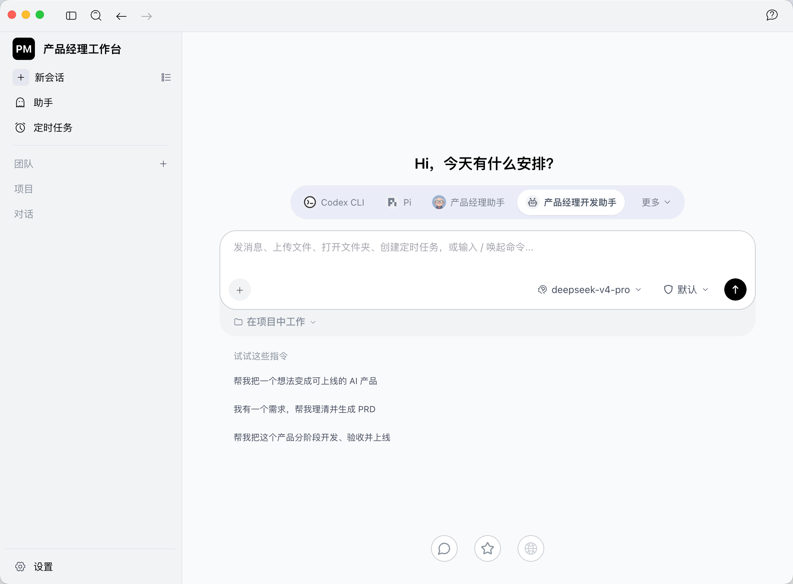

# 产品经理工作台

把需求梳理、项目资料、AI 对话与工具调用集中到一个个人桌面工作台。这里发布当前个人使用版本的前后端源码与集成模块。

## 工作台能力

- **AI 协作**：会话、助手、项目文件、团队与定时任务入口。
- **模型管理与对比**：服务商配置，同题比较 2–4 个模型输出，支持停止、重试及保存。待配置平台模板不等于已接通模型。
- **蓝图 Agent 2.0**：从点子 / PRD 到分阶段推导、架构方案、审稿及断点续跑。
- **拆拆助手**：面向软件包与编译产物的静态分析、证据定位及解释。
- **Ego 浏览器**：浏览器 MCP 接入代码与配置示例。
- **桌面宠物**：原生桌宠及角色资源，包含摸摸、喂食、聊天、专注计时、小游戏、休息及窗口跟随相关代码。
- **中文技能目录**：内置技能介绍及 97 个本机导入技能的中文目录。个人与第三方技能全文需在拥有权限的本机重新导入。



## 源码结构

```text
AionUi/       Electron 前端与桌面进程
AionCore/     Rust 后端
integrations/ 蓝图、拆拆、Ego、桌宠与技能目录
docs/         修改说明、版权与历史来源
```

两个助手同时保留在工作台中，也可独立下载：

- [Agent 蓝图 2.0](https://github.com/fengwunongyinghuachuanyi/agent-blueprint-2.0)
- [拆拆](https://github.com/fengwunongyinghuachuanyi/chaichai)

## 配置与构建

保持 `AionUi/` 和 `AionCore/` 同级。前端按 [桌面端说明](AionUi/readme.md) 与 [package.json](AionUi/package.json) 安装依赖；后端按 [架构文档](AionCore/ARCHITECTURE.zh-CN.md) 与 [justfile](AionCore/justfile) 准备 Rust 工具链并构建。

各助手需要重新导入配置：[蓝图](integrations/agent-blueprint-2/README.md) · [拆拆](integrations/chaichai/README.md) · [Ego](integrations/ego-browser/README.md) · [桌宠](integrations/openpets/README.md)。配置示例的 `/ABSOLUTE/PATH/`、`/PATH/TO/` 等占位需改为实际路径。个人账号、API Key、运行时依赖及聊天记录不随源码发布。普通 API 模型需要自行配置；蓝图适配器复用本机 Codex 登录，在云端推理。

本次发布是源码快照，未制作新的安装包，也未重新执行全量前后端构建。集成时的本机验证记录仅代表当时覆盖的链路，迁移机器后需要重新构建和验证。
